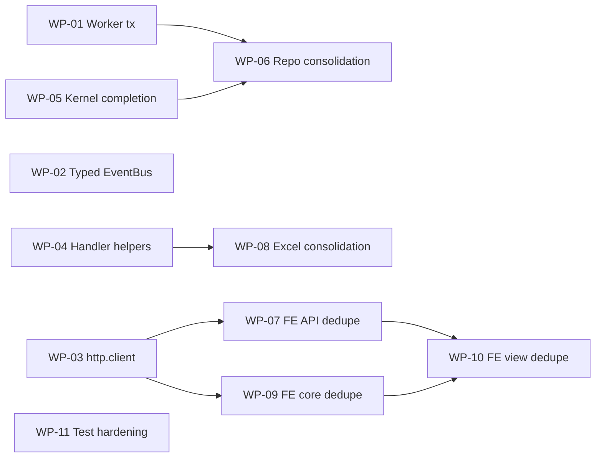

# DRY Remediation Roadmap & Agent Playbook

> **Sumber audit:** `dry_scheme_review.md` (audit DRY 2026-10-29, Backend Go + Frontend Vue 3/TS).
> **Status dokumen:** Living document. Setiap agen **wajib** memperbarui tabel [§3 Status Board](#3-status-board) saat mengklaim dan menyelesaikan Work Package (WP).
> **Catatan:** `docs/` masuk `.gitignore` — dokumen ini lokal, tidak ikut ter-commit.

---

## 0. Cara Memakai Dokumen Ini (Wajib Dibaca Agen)

1. Baca **§1 Aturan Global** dan **§2 Kendala Environment** sebelum menyentuh kode.
2. Pilih **satu** WP berstatus `TODO` yang semua dependensinya `DONE` (lihat [§4 Dependency Graph](#4-dependency-graph)).
3. Klaim WP: ubah status menjadi `IN_PROGRESS (<agent-id>, <tanggal>)` di §3.
4. Kerjakan **hanya** file di kolom _File Ownership_ WP tersebut. Jika butuh menyentuh file milik WP lain → berhenti, laporkan ke orchestrator/user.
5. Jalankan seluruh **Verifikasi** WP. Jangan klaim lulus untuk perintah yang tidak dijalankan atau gagal.
6. Isi **Laporan Penyelesaian** ([§7 Template](#7-template-laporan-penyelesaian)) dan ubah status menjadi `DONE` / `BLOCKED`.

---

## 1. Aturan Global (Non-Negotiable)

| #   | Aturan                                                                                                                                                     | Sumber                             |
| :-- | :--------------------------------------------------------------------------------------------------------------------------------------------------------- | :--------------------------------- |
| G1  | Baca `.agent/rules/projectrules.md`, `.agent/rules/golang_paradigms.md`, `.agent/rules/vue.md`, `.agent/rules/js-modern-utils.md`.                         | Project rules                      |
| G2  | Untuk pertanyaan arsitektur, jalankan dulu `graphify query "<pertanyaan>"`; setelah mengubah kode jalankan `graphify update .`.                            | `.agents/rules/graphify.md`        |
| G3  | Verifikasi skema via `.agent/context/schema.sql` / MySQL MCP sebelum menulis SQL atau mengubah tipe field entity.                                          | Project rules §3                   |
| G4  | **Dilarang** menambah dependency (Go module / npm package) tanpa persetujuan user. Cek `backend/go.mod` / `frontend/package.json` dulu.                    | Project rules §8                   |
| G5  | Transaksi **hanya** via `database.TransactionManager.WithTransaction(ctx, ...)`. Dilarang `db.BeginTxx` di luar `shared/database/transaction.go`.          | Project rules §10                  |
| G6  | `gin.Context` tidak boleh keluar dari `adapter/inbound/http`. Domain tidak boleh mengimpor `shared/database`.                                              | Project rules §10                  |
| G7  | Godoc wajib untuk simbol exported baru. Strict typing (hindari `any`/`interface{}` bila tipe diketahui).                                                   | Project rules §4                   |
| G8  | **Kontrak JSON API tidak boleh berubah** (nama key, casing, tipe) kecuali frontend consumer ikut diperbarui dalam WP yang sama.                            | Project rules §5                   |
| G9  | **Dilarang menghapus** file untracked / gitignored (mis. `docs/`, `scratch/`, `scripts/`) tanpa konfirmasi eksplisit user — tidak bisa dipulihkan via git. | Pelajaran insiden `docs/frontend/` |
| G10 | File eksperimen/sementara hanya di `scratch/`. Logic permanen wajib disertai `_test.go` / `*.test.ts`.                                                     | Project rules §11                  |
| G11 | Jangan menulis ulang file utuh; lakukan edit minimal dan pertahankan komentar yang tidak terkait.                                                          | User rules                         |
| G12 | **Git commit atomik per WP:** Commit setiap WP selesai dengan format `refactor(dry): [WP-XX] <deskripsi>` untuk mempermudah audit & rollback jika regresi. | Git hygiene                        |
| G13 | Setiap modifikasi provider DI di `cmd/api` atau `cmd/worker`, wajib jalankan `wire ./...` dan pastikan `wire_gen.go` sinkron.                               | Project rules §10                  |

---

## 2. Kendala Environment yang Diketahui

| Kendala                                                                                                 | Dampak                                                                                             | Penanganan                                                                                                                                               |
| :------------------------------------------------------------------------------------------------------ | :------------------------------------------------------------------------------------------------- | :------------------------------------------------------------------------------------------------------------------------------------------------------- |
| Node.js aktif adalah **v24.5.0** (NVM di `C:\nvm4w\nodejs`). Path default sebelumnya menunjuk Node 21 lama di `Program Files`. | `npm run build` ✅ sukses (built 25.4s, PWA generated); vitest jalan normal.                      | Pastikan subshell/command selalu menyertakan `C:\nvm4w\nodejs` di `$env:PATH`.                                                                          |
| `vue-tsc --noEmit` tidak memeriksa SFC `<script setup>` tanpa `lang="ts"`.                              | Mayoritas komponen analytics & WMS **tidak ter-type-check**.                                       | Jangan klaim "type-safe" untuk SFC JS. Verifikasi manual nama method/import (grep).                                                                      |
| `go test ./...` gagal di `cmd/worker` (butuh env `DB_DSN`).                                             | False negative.                                                                                    | Gunakan `go test ./internal/...`.                                                                                                                        |
| `TestSlotService_GetPickingLocationsForKelja` **flaky** (kemungkinan urutan iterasi map).               | Gagal acak.                                                                                        | Ditangani di **WP-11**. Jangan "memperbaiki" dengan menghapus assertion.                                                                                 |

---

## 3. Status Board

| WP    | Judul                                                                                     | Prioritas | Status                                | Dependensi               |
| :---- | :---------------------------------------------------------------------------------------- | :-------: | :------------------------------------ | :----------------------- |
| WP-A  | Auth context & helper HTTP (`GetUserID`, 18 bug `"userID"`)                               |    P0     | ✅ DONE                               | —                        |
| WP-B  | `kernel.BaseEntity/ImmutableEntity/SoftDeletable` (3 entity + 2 log)                      |    P1     | ✅ DONE (parsial, lanjut di WP-05)    | —                        |
| WP-C  | Hapus utils legacy analytics, `useInfiniteScroll.ts`, fix `productApi` & `BatchLogs` args |    P1     | ✅ DONE                               | —                        |
| WP-00 | Deteksi Node.js 24.5.0 (NVM) & verifikasi `npm run build`                                  |    P0     | ✅ DONE                               | —                        |
| WP-01 | Worker: transaksi `SKIP LOCKED` + generic dispatcher                                      |  **P0**   | ✅ DONE                               | —                        |
| WP-02 | EventBus bertipe + idempotensi `1062` + audit-log helper                                  |  **P0**   | ✅ DONE                               | —                        |
| WP-03 | Frontend `http.client.ts` unification + bug Blob `exportStock`                            |  **P0**   | ✅ DONE                               | —                        |
| WP-04 | Handler: adopsi `ParseIntParam`, `HandleDomainError`, `SaveImportUpload`                  |    P0     | ✅ DONE                               | —                        |
| WP-05 | Kernel completion (entity drift & append-only)                                            |    P1     | ✅ DONE                               | —                        |
| WP-06 | Repository consolidation (`FetchPaginated`, `BaseRepository`, `GetExt`)                   |    P1     | ✅ DONE                               | WP-01, WP-05             |
| WP-07 | Frontend API dedupe + `serializeFilterParams`                                             |    P1     | ✅ DONE                               | WP-03                    |
| WP-08 | Excel importer/template consolidation                                                     |    P2     | ✅ DONE                               | WP-04                    |
| WP-09 | Frontend core dedupe (`useInlineSave<T>`, job-queue store, formatter)                     |    P2     | ✅ DONE                               | WP-03                    |
| WP-10 | Frontend view dedupe (Product/Package management, Job History)                            |    P2     | TODO                                  | WP-07, WP-09             |
| WP-11 | Test hardening (flaky test, coverage helper baru)                                         |    P2     | TODO                                  | —                        |

---

## 4. Dependency Graph



**Paralel aman (tanpa konflik file):** {WP-01, WP-02, WP-04, WP-05, WP-11} untuk backend; WP-03 untuk frontend.

---

## 5. File Ownership Matrix (Cegah Konflik Paralel)

| Area / File                                                                                                                                                           | Pemilik                                   |
| :-------------------------------------------------------------------------------------------------------------------------------------------------------------------- | :---------------------------------------- |
| `backend/cmd/worker/**`, `system/adapter/outbound/mysql/job_repository.go`                                                                                            | WP-01 (lalu WP-06 untuk generic job repo) |
| `backend/internal/shared/eventbus/**`, `shared/event/**`, `*/adapter/inbound/rabbitmq/**`, `system/adapter/inbound/event/**`, usecase yang membangun `EventSystemLog` | WP-02                                     |
| `*/adapter/inbound/http/*_handler.go`, `shared/utils/response.go`, `shared/utils/errors.go` (baru), `shared/utils/upload.go` (baru)                                   | WP-04                                     |
| `*/domain/*.go`, `shared/kernel/**`                                                                                                                                   | WP-05                                     |
| `*/adapter/outbound/mysql/*_repository.go` (kecuali `job_repository.go` sebelum WP-01 selesai), `shared/utils/repository.go`, `shared/database/**`                    | WP-06                                     |
| `internal/parser/**`, importer di `*_service.go`/`*_parser.go`                                                                                                        | WP-08                                     |
| `frontend/src/core/infrastructure/http.client.ts`, `*/application/use*.ts` (hanya hapus double toast)                                                                 | WP-03                                     |
| `frontend/src/modules/*/infrastructure/*.api.ts`                                                                                                                      | WP-07                                     |
| `frontend/src/core/presentation/**`, `core/utils/**`                                                                                                                  | WP-09                                     |
| `frontend/src/modules/master_data/presentation/**`, komponen Job History                                                                                              | WP-10                                     |

> Jika WP-04 dan WP-02 sama-sama perlu file usecase yang sama (mis. `paper_size_service.go`), WP-02 yang memiliki; WP-04 tidak menyentuh usecase.

---

## 6. Work Packages

### WP-00 — Node.js 24.5.0 Discovery & Runtime Verification (DONE)

- **Status:** ✅ SELESAI. Node.js `v24.5.0` aktif di `C:\nvm4w\nodejs` (NVM for Windows). Agen sebelumnya salah mengeksekusi binary lama di `C:\Program Files\nodejs\node.exe` (v21.6.2).
- **Hasil:**
  - `npm run build` ✅ LULUS (`built in 25.42s`, precache PWA 176 entries).
  - `npx vitest run` ✅ LULUS eksekusi runtime jsdom (10 gagal dari 56 tes karena bug kontrak mock `http` yang ditargetkan di WP-03).
- **Instruksi Agen:** Pastikan subshell/command selalu menyertakan `C:\nvm4w\nodejs` di `$env:PATH`.

---

### WP-01 — Worker: Transaksi `FOR UPDATE SKIP LOCKED` + Generic Dispatcher (P0, Bug Produksi)

**Masalah:**

- `backend/cmd/worker/main.go:169` & `:299` memanggil `db.BeginTxx(ctx, nil)` tanpa menyuntikkan `tx` ke `ctx`. `ClaimNextImportJob`/`ClaimNextExportJob` (`job_repository.go:93`, `:166`) memakai `database.GetExt(ctx, r.db)` → jatuh ke koneksi non-transaksi → **row lock `SKIP LOCKED` hilang** → dua worker dapat mengklaim job yang sama.
- `processPendingImportJobs` (`main.go:162-290`) & `processPendingExportJobs` (`:292-375`) duplikat (semaphore, `WaitGroup`, timeout 10 menit, sinyal Firebase).
- `GetImportJobByID` / `GetExportJobByID` mengembalikan `&job, err` non-nil saat `sql.ErrNoRows`.

**Langkah:**

1. Tambahkan `database.TransactionManager` ke DI worker (`cmd/worker` provider set + regenerate `wire_gen.go` via `wire`). Worker saat ini **belum** memiliki `txManager`.
2. Klaim job di dalam `txManager.WithTransaction(ctx, func(ctx) error { job = ClaimNext...; UpdateStatus(PROCESSING); return nil })`. **Commit sebelum** pemrosesan job berat (jangan tahan transaksi selama 10 menit).
3. `ClaimNext*Job`: kembalikan `nil, nil` saat `sql.ErrNoRows` (tidak ada job ≠ error). `Get*JobByID`: kembalikan `nil, err`.
4. Ekstrak higher-order generic, contoh kontrak:

   ```go
   // dispatchJobs mengklaim dan memproses job secara konkuren dengan batas semaphore.
   func dispatchJobs[J any](ctx context.Context, cfg dispatchConfig, claim func(ctx context.Context) (*J, error), process func(ctx context.Context, job *J) error)
   ```

5. Hapus kedua `db.BeginTxx` di `main.go`.

**Acceptance Criteria:**

- `Select-String -Path backend -Recurse -Pattern "BeginTxx"` hanya muncul di `shared/database/transaction.go`.
- Unit test `dispatchJobs` dengan claimer mock: (a) `nil, nil` → tidak memanggil `process`; (b) error `process` tidak menghentikan job lain; (c) concurrency ≤ limit.

**Verifikasi:** `go build ./...`, `go vet ./...`, `go test ./internal/... ./cmd/worker/...` (tandai `cmd/worker` _skipped_ bila `DB_DSN` tidak ada).

**Risiko:** Durasi transaksi klaim harus singkat; jangan bungkus `process` di dalam transaksi klaim.

---

### WP-02 — EventBus Bertipe + Idempotensi + Audit Log Helper (P0, Bug Produksi)

**Masalah:**

- `stock_consumer.go:44`: `if err.Error() != ""` menganggap **semua** error DB sebagai duplicate event → pesan di-ACK diam-diam (data hilang).
- `eventbus/event.go:8` `Payload interface{}` → double `json.Marshal`/`Unmarshal` di tiap consumer (`stock_consumer.go:56-73`, `log_listener.go:33-41`).
- `LogListener` belum didaftarkan; paket `internal/shared/event/` (114 LOC) mati (0 referensi).
- `8+` usecase mengulang ±14 baris konstruksi `EventSystemLog` (mis. `misc/application/usecase/paper_size_service.go:50-63`).

**Langkah:**

1. Deteksi duplikat dengan `github.com/go-sql-driver/mysql` (**sudah ada** di `go.mod` v1.10.0):

   ```go
   var mysqlErr *mysql.MySQLError
   if errors.As(err, &mysqlErr) && mysqlErr.Number == 1062 { /* duplicate → ACK */ }
   // error lain → NACK/requeue atau DLQ, jangan ACK
   ```

   Letakkan helper `IsDuplicateKey(err) bool` di **adapter/outbound** atau `shared/database` (bukan domain).

2. Ubah `Event.Payload` ke `json.RawMessage`; tambah `SubscribeTyped[T any](bus, eventType, func(ctx, T) error)`. Pertahankan kompatibilitas publisher yang ada.
3. Daftarkan `LogListener` di composition root (`cmd/api` / `cmd/worker` via wire).
4. Hapus `internal/shared/event/` **setelah** `graphify query` / grep membuktikan 0 referensi.
5. Tambah `eventbus.PublishAuditLog(ctx, bus, AuditLogInput{...})` dan ganti blok `EventSystemLog` berulang.

**Acceptance Criteria:**

- Test: error non-1062 → **tidak** ACK; error 1062 → ACK tanpa reprocess.
- `Select-String ... -Pattern 'err.Error\(\) != ""'` = 0 di consumer.
- Tidak ada `json.Marshal(evt.Payload)` + `json.Unmarshal` berurutan di consumer.

**Verifikasi:** `go build ./...`, `go test ./internal/shared/eventbus/... ./internal/modules/inventory/...`. Gunakan **RabbitMQ MCP** untuk memastikan nama exchange/queue/DLQ tidak berubah.

**Risiko:** Perubahan format pesan di wire RabbitMQ dapat memutus consumer versi lama selama rolling deploy — pertahankan bentuk JSON payload identik.

---

### WP-03 — Frontend `http.client.ts` Unification + Bug Blob (P0)

**Masalah:**

- `http.client.ts:33-83` mengekspor dua kontrak: `{ http }` (mengembalikan `res.data`) & default instance (mengembalikan `AxiosResponse`).
- Interceptor sukses tidak menolak `success === false` → `84` cek manual `.success`.
- Interceptor error sudah `toast(...)`, tetapi composable (`useStock.ts:23`, `useProducts.ts:26`, `useInstantInlineEdit.ts:29`) toast lagi → **double toast**.
- `stock.api.ts:23-29` `exportStock` me-return `response.data` padahal `http.get` sudah mengembalikan `Blob` → `undefined`.
- `BatchLogs.vue` mengirim `user` sedangkan backend `BatchLogFilter` membaca `userId` → filter user diabaikan.

**Langkah:**

1. Interceptor sukses: jika `response.config.responseType !== 'blob'` dan `response.data?.success === false` → `Promise.reject` dengan `message`.
2. Tambah helper eksplisit `http.blob(url, config)` dan `http.upload(url, formData, config)`; tambah opsi config `silentErrorToast?: boolean`.
3. Fix `exportStock` → `return http.blob('/wms/stock/export', { params: filter })`.
4. Hapus toast error duplikat di composable (biarkan interceptor), kecuali pesan kontekstual yang berbeda — gunakan `silentErrorToast` untuk itu.
5. Fix `BatchLogs.vue`: kirim `userId` (sesuai `inventory_dto.BatchLogFilter`/`BatchLogExportRequest`, tipe export `int`).
6. **Jangan** hapus default export dulu; tandai `@deprecated` dan migrasi bertahap di WP-07.

**Acceptance Criteria:**

- Endpoint non-standar diverifikasi tidak rusak: `report_handler.go:62`, `user_handler.go:43` (login), endpoint unduhan Blob.
- Test vitest untuk interceptor: `success:false` → reject; Blob → tidak diperiksa `success`; `silentErrorToast` → tidak toast.

**Verifikasi:** `npx vue-tsc --noEmit`, `npx vitest run src/core`, `npm run build` (**butuh WP-00**; bila belum, laporkan _unverified_).

**Risiko:** False-positive rejection pada endpoint yang memakai `RawResponse` tanpa field `success`.

---

### WP-04 — Handler Helpers Adoption (P0)

**Status awal:** `utils.ParseIntParam` & `utils.ParsePagination` sudah ada (`shared/utils/response.go`) tetapi **0 pemanggil**; `49` titik `strconv.Atoi(c.Param(...))` tersisa (termasuk `id, _ :=` yang mengabaikan error).

**Langkah:**

1. Tambah batas atas di `ParsePagination` (cegah `limit=1000000`):

   ```go
   const maxPageLimit = 500
   if limit < 1 || limit > maxPageLimit { limit = defaultLimit }
   ```

2. Ganti seluruh `strconv.Atoi(c.Param(...))` dengan:

   ```go
   id, ok := utils.ParseIntParam(c, "id")
   if !ok { return }
   ```

   Pertahankan pesan error spesifik bila dibutuhkan kontrak (cek `docs/openapi.json`).

3. Buat `utils.HandleDomainError(c, err)` (map `1062` → 409 `CONFLICT`, `1452` → 400 `INVALID_REFERENCE`, `sql.ErrNoRows` → 404). Ganti string-matching di `admin_user_handler.go:60-155`.
4. Buat `utils.SaveImportUpload(c, field, subdir) (savedPath, originalName string, ok bool)` dengan `filepath.Base` + prefix `time.Now().UnixNano()` (atau UUID bila sudah ada di go.mod), path absolut dari `config.AppConfig.StoragePath`. Terapkan di 7 handler upload (`stock_handler.go:35-71`, `attendance_handler.go`, `schedule_handler.go`, `media_handler.go`, `package_handler.go`, `product_handler.go`, dll.).

**Acceptance Criteria:**

- `strconv.Atoi(c.Param` di `*_handler.go` = 0.
- Tidak ada `c.SaveUploadedFile(file, <dir> + file.Filename)` mentah.
- Unit test `HandleDomainError` & `SaveImportUpload` (gunakan `t.TempDir()`, bukan file system nyata di repo).

**Verifikasi:** `go build ./...`, `go test ./internal/shared/...`.

**Risiko:** Mengubah pesan error/status code dapat memengaruhi frontend yang mencocokkan string pesan.

---

### WP-05 — Kernel Completion (P1)

**Status awal:** `Category`, `Product`, `User`, `ProductImage`, `ProductAuditLog` sudah memakai `kernel.*`; `shared/database/base.go` berisi type alias untuk kompatibilitas.

**Target:**

- Entity mutable drift: `inventory/domain/slot.go`, `stock_request.go`, `return.go` (**JSON `createdAt` camelCase**), `stock_transaction.go` (**`uint`**), `hris/domain/shift.go` & `system/domain/job.go` (**`*time.Time`**).
- Append-only: `Location`, `OutboxEvent`, `ProductLocationSlotLog`, `StockMovement`, `TransactionMovement`, `SystemLog`, `ExportJob`.
- `inventory/domain/location.go`: `DeletedAt` manual → `kernel.SoftDeletable`.

**Aturan Keputusan per Entity:**

1. Cek kolom di schema (nullable? tipe?). Jika `created_at`/`updated_at` nullable → **jangan** paksa `time.Time`; biarkan manual + komentar alasan.
2. Jika JSON tag berbeda dari `kernel` (mis. `createdAt`) → **jangan** embed kecuali semua consumer frontend diperbarui (grep `createdAt` di `frontend/src`). Jika tidak diperbarui, biarkan manual + komentar `// keep: JSON contract camelCase`.
3. `uint` → `int` hanya jika semua pemanggil (`uint(userID)` di `stock_transaction_handler.go`) ikut disesuaikan.
4. Struct literal yang mengisi `ID:` langsung wajib diubah ke `BaseEntity: kernel.BaseEntity{ID: ...}`.

**Acceptance Criteria:** `go build ./...` bersih; `Select-String backend/internal/modules/*/domain -Pattern "shared/database"` = 0; tabel keputusan per entity ditulis di Laporan.

**Risiko:** Silent JSON contract break bila tag berubah.

---

### WP-06 — Repository Consolidation (P1)

**Masalah:** `utils.DBExt` menduplikasi `database.ExtContext`; 6 pemanggil `utils.FetchPaginated` mengoper `r.db` mentah (lewat transaksi). `115` panggilan langsung `r.db.*Context`. `4` paginasi manual `COUNT(*)` (`media_repository.go:103-153`, `slot_repository.go:153-181`, `product_repository.go:408-462`, `investigation_repository.go:192-275`). `8` repo CRUD belum embed `BaseRepository[T]`.

**Langkah:**

1. Pindahkan `FetchPaginated[T]` ke `shared/database/paginate.go` dengan signature menerima `ctx` dan memanggil `GetExt(ctx, db)` internal. Sisakan wrapper `@deprecated` di `utils` sampai semua caller pindah, lalu hapus `utils.DBExt`.
2. Caller saat ini: `return_repository.go:63`, `stock_repository.go:202,251`, `job_repository.go:59,139`, `system_log_repository.go:129`.
3. Konversi 4 paginasi manual ke `FetchPaginated`.
4. Embed `BaseRepository[T]` di: `shift`, `admin_user`, `sales_channel`, `slot`, `paper_size`, `sticker_template`, `media`, `setting`. Hapus override redundan (`category_repository.go` `FindAllActive`/`Delete`, `role_repository.go` `GetRoles`/`DeleteRole`) bila perilakunya identik.
5. Satukan `Create` & `CreateProductTx` di `product_repository.go:35-85` (keduanya sudah `GetExt`).
6. Generic job repo (`ImportJob`/`ExportJob`) **setelah WP-01 DONE**.
7. Ganti `r.db.(Exec|Get|Select)Context` → `database.GetExt(ctx, r.db).*`.

**Acceptance Criteria:** `Select-String -Pattern "r\.db\.(Exec|Get|Select|Query)"` di repository = 0 (kecuali dijustifikasi); `utils.DBExt` dihapus; repo test (mock/sqlmock hanya jika sudah ada di go.mod — **saat ini tidak ada**, jadi gunakan interface mock).

**Risiko:** `BaseRepository.SoftDelete` memakai `deleted_at`/`is_active` berdasarkan tag — pastikan perilaku delete repo lama (hard vs soft) tidak berubah diam-diam.

---

### WP-07 — Frontend API Dedupe (DONE)

**Target:**

- `stock.api.ts`: `transferStock` (L31) & `processSingleTransfer` (L81) identik dengan `wms.api.ts:86` → satu sumber.
- `GET /locations` (`location.api.ts` & `stock.api.ts:39`), `/packages/export` & `/packages/batch/update` (`product.api.ts:45-56` vs `package.api.ts`), `GET /reports/my-jobs` (3 tempat).
- `35` file non-infrastructure mengimpor `http.client` langsung (termasuk `ShopPerformanceStats.vue:8`, `MediaPickerModal.vue:5,7`, `ProductImageModal.vue:6,8` yang import dua kali).
- Buat `serializeFilterParams()` untuk payload `TriStateSelect` (`{ include: string[], exclude: string[] }` → serialisasi konsisten query param array vs JSON string sesuai Gin handler).
- Migrasi SFC Analytics ke `<script setup lang="ts">` (`InventoryValueStats.vue`, `ShopPerformanceStats.vue`, `StockMovementStats.vue`, `TimePerformanceStats.vue`, `PackageAnalysisTable.vue`, `StockTimelineSlider.vue`) agar `vue-tsc` memverifikasi panggilan method `analyticsApi`.
- `useAnalytics.ts` (0 pemakai): putuskan **adopsi** (komponen analytics via composable) atau **hapus**; tulis keputusan di Laporan.

**Acceptance Criteria:** Setiap endpoint hanya didefinisikan di satu `*.api.ts`; grep `from '@/core/infrastructure/http.client'` hanya di `*/infrastructure/*.api.ts` dan `core/`; 6 SFC analytics berstatus `lang="ts"` dan lulus `vue-tsc`.

**Verifikasi:** `npx vue-tsc --noEmit` + grep manual nama method untuk SFC JS; `npm run build` (butuh WP-00).

---

### WP-08 — Excel Importer/Template Consolidation (DONE)

- `schedule_parser.go`, `stock_service.go` (×2), `media_service.go` → pakai `internal/parser/base_parser.go` `ReadExcel` (L62-101).
- `stock_service.go:472-545` `GenerateAdjustmentTemplate` & `GenerateInboundTemplate` (95% identik) → satu fungsi berparameter (header, sheet name, contoh baris).
- **Verifikasi:** test table-driven memakai file `.xlsx` yang dibuat di `t.TempDir()` dengan `excelize` (sudah ada di go.mod).

---

### WP-09 — Frontend Core Dedupe (DONE)

- `useInlineSave.ts`: generik `useInlineSave<T>({ save: (id, payload) => Promise<void>, ... })`; keluarkan URL `/products/${id}` & `payload.components` dari `core/`; ganti `productsSource.find` dalam loop dengan `Map` (O(1)).
- `useSmartGrid.ts:85-90`: hapus hardcode kolom `price`/`weight` → konfigurasi dari pemanggil.
- `downloadStore.ts` + `uploadStore.ts` (90% identik) → `createJobQueueStore(name, api)`.
- `useFirebaseListener.ts`: perbaiki registrasi `onUnmounted` ganda.
- `formatters.ts:151`: `label.charCodeAt(2)` → hash aman untuk label < 3 karakter (mis. reduce semua char).
- `42+` inline `Intl.NumberFormat` / `toLocaleString('id-ID')` / `toLocaleDateString` → `formatCurrency`/`formatNumber`/`formatDate`.
- `useStock.ts:35-41` `URL.createObjectURL` manual → `useDownload.ts`.
- **Acceptance:** test vitest untuk `formatters` (label 1–2 karakter) dan `createJobQueueStore`.

---

### WP-10 — Frontend View Dedupe (P2)

- `ProductManagement.vue` (626 LOC) & `PackageManagement.vue` (485 LOC) ~75% identik → ekstrak composable `useCatalogManagement`; ganti `ids.forEach` + `products.value.find` (O(N²)) dengan `Map`.
- `BatchEditModal.vue` & `PackageBatchEditModal.vue` (~85% identik) → satu komponen berparameter.
- Tabel Job History & status badge (6 duplikat) → komponen `core/presentation/components/ui/JobHistoryTable.vue`.

---

### WP-11 — Test Hardening (P2)

- Perbaiki flaky `TestSlotService_GetPickingLocationsForKelja` (`inventory/application/usecase/slot_service_test.go:318`): identifikasi sumber non-determinisme (urutan map / sort tidak stabil) dan perbaiki **di kode produksi** bila urutan picking memang harus deterministik (cek `docs/wms_locational_metadata_slotting_master_plan.md`), bukan dengan melonggarkan assertion.
- Verifikasi dengan `go test -run TestSlotService_GetPickingLocationsForKelja -count=50 ./internal/modules/inventory/application/usecase/`.

---

## 7. Template Laporan Penyelesaian

Tambahkan di bawah §8 (Log), satu blok per WP:

```markdown
### [WP-XX] <Judul> — <DONE | BLOCKED> (<agent-id>, <YYYY-MM-DD>)

**Ringkasan perubahan:** <1–3 kalimat>
**File diubah:** <daftar path>
**Keputusan desain:** <mis. tabel keputusan entity WP-05, adopsi/hapus useAnalytics WP-07>
**Verifikasi dijalankan:**
| Perintah | Hasil |
| :-- | :-- |
| `go build ./...` | ✅ / ❌ (<ringkas error>) |
**Tidak terverifikasi / di luar scope:** <wajib diisi jujur, mis. "vitest tidak jalan karena Node 21">
**Bug lama yang ditemukan (tidak diperbaiki):** <daftar>
**Risiko tersisa:** <1 bullet>
```

---

## 8. Log Penyelesaian

### [WP-A] Auth context & helper HTTP — DONE (orchestrator, 2026-10-29)

**Ringkasan:** Konstanta `ContextUserIDKey`/`ContextRoleIDKey`/`ContextUsernameKey` + `GetUserID`/`GetRoleID`/`GetUsername` di `shared/middleware/auth_middleware.go`; 6 duplikat `getUserID` dihapus; 18 bug `"userID"` diperbaiki; `RequirePermission` mendelegasikan ke `RequireAnyPermission` tanpa menahan lock selama query DB; `ParseIntParam`/`ParsePagination` ditambahkan (belum diadopsi → WP-04).
**Verifikasi:** `go build ./...` ✅; `go test ./internal/shared/...` ✅. `go test ./...` ❌ (`cmd/worker` butuh `DB_DSN`; flaky slot test → WP-11).
**Perubahan perilaku:** `role_id == 0` kini langsung 403 `No role assigned`.

### [WP-B] Kernel entity (parsial) — DONE (orchestrator, 2026-10-29)

**Ringkasan:** `shared/kernel/entity.go` (+ test); `Category`, `Product` (+`SoftDeletable`), `User`, `ProductImage`, `ProductAuditLog` dimigrasi; alias di `shared/database/base.go`.
**Verifikasi:** `go build ./...` ✅; `go test ./internal/shared/kernel/...` ✅.

### [WP-C] Frontend legacy cleanup — DONE (orchestrator, 2026-10-29)

**Ringkasan:** 7 caller dimigrasi ke `analyticsApi`; `analytics/application/utils/*` & `useInfiniteScroll.ts` dihapus; import `productApi` di `ProductManagement.vue`/`PackageManagement.vue`; argumen `BatchLogs.vue` diperbaiki sesuai `BatchLogFilter`/`BatchLogExportRequest`.
**Verifikasi:** `vue-tsc --noEmit` ✅; `npm run build` ✅ lulus pada Node 24.5.0 (`built in 25.42s`).
**Insiden:** `docs/frontend/` (~4.8MB, gitignored) terhapus permanen tanpa konfirmasi → aturan **G9**.
**Bug lama ditemukan:** `BatchLogs.vue` `user` vs `userId` (→ WP-03); `ShopPerformanceStats.vue` import `http.client` langsung (→ WP-07).

### [WP-00] Deteksi Node.js 24.5.0 (NVM) & Build Verification — DONE (orchestrator, 2026-10-29)

**Ringkasan:** Agen sebelumnya memanggil binary usang `C:\Program Files\nodejs\node.exe` (v21.6.2). Node.js aktif environment pengguna sebenarnya adalah `v24.5.0` via NVM di `C:\nvm4w\nodejs`. Dengan Node 24.5.0, seluruh blocker build frontend dan runtime jsdom langsung terselesaikan.
**Verifikasi:**
| Perintah | Hasil |
| :-- | :-- |
| `& "C:\nvm4w\nodejs\node.exe" -v` | ✅ `v24.5.0` |
| `npm run build` | ✅ `built in 25.42s` (PWA 176 entries) |
| `npx vitest run` | ✅ Eksekusi runtime berhasil (10 failed adalah bug kontrak mock WP-03, bukan error environment) |
**Dampak:** WP-03, WP-07, dan WP-09 unblocked sepenuhnya tanpa perlu intervensi manual user.
**Risiko tersisa:** Subshell/terminal baru harus selalu memastikan path `C:\nvm4w\nodejs` berada di urutan pertama `$env:PATH`.

### [WP-01] Worker: Transaksi `SKIP LOCKED` + Generic Dispatcher — DONE (orchestrator, 2026-10-29)

**Ringkasan:** Menginjeksi `database.TransactionManager` ke `WorkerContainer` via Wire (`wire ./cmd/worker`). Memperbaiki `ClaimNextImportJob` dan `ClaimNextExportJob` untuk mengembalikan `nil, nil` saat `sql.ErrNoRows` (serta `nil, err` pada `GetJobByID`). Mengubah perulangan konkuren di `main.go` dengan higher-order generic `dispatchJobs[J any]` di `cmd/worker/dispatcher.go`. Menghapus seluruh panggilan `db.BeginTxx` di `main.go`. Menambahkan unit test komprehensif di `cmd/worker/dispatcher_test.go`.
**File diubah:**
- `backend/internal/di/container.go`
- `backend/cmd/worker/wire_gen.go`
- `backend/cmd/worker/main.go`
- `backend/cmd/worker/dispatcher.go` (baru)
- `backend/cmd/worker/dispatcher_test.go` (baru)
- `backend/cmd/worker/stock_trigger_test.go`
- `backend/internal/modules/system/adapter/outbound/mysql/job_repository.go`
- `.gitignore` (perbaikan filter path `backend/cmd/worker/`)
**Verifikasi:**
| Perintah | Hasil |
| :-- | :-- |
| `go build ./...` | ✅ Lulus (exit code 0) |
| `go vet ./...` | ✅ Lulus (exit code 0) |
| `go test -v ./cmd/worker/...` | ✅ 5 test lulus (`TestDispatchJobs_*`), 1 test di-skip (live DB integration) |
| `go test ./internal/shared/... ./internal/modules/system/...` | ✅ Lulus 100% |
| `Select-String -Path backend -Recurse -Pattern "BeginTxx"` | ✅ Hanya 1 kemunculan di `shared/database/transaction.go:29` |
**Risiko tersisa:** Transaksi klaim dijamin singkat (hanya lock & update status PROCESSING), namun handler pemrosesan job di dalam goroutine harus tetap mematuhi timeout konteks (10 menit).

### [WP-02] EventBus Bertipe + Idempotensi 1062 + Audit Log Helper — DONE (orchestrator, 2026-10-29)

**Ringkasan:** Menambahkan helper `database.IsDuplicateKey(err)` (MySQL 1062) dan `IsForeignKeyViolation(err)` (MySQL 1452). Mengubah `Event.Payload` ke `json.RawMessage` dengan helper `SubscribeTyped[T]`, `SubscribePayload[T]`, dan `PublishAuditLog`. Menghapus double-marshaling di `stock_consumer.go` dan `log_listener.go`. Menginjeksi dan mendaftarkan `LogListener` ke composition root worker via Wire. Menghapus paket mati `shared/event`. Mengadopsi `eventbus.PublishAuditLog` di usecase `misc`, `inventory`, dan `iam` sehingga menghilangkan 22 blok kode repetitif dan menghapus direct import cross-domain `system_domain`.
**File diubah:**
- `backend/internal/shared/database/errors.go` (baru)
- `backend/internal/shared/database/errors_test.go` (baru)
- `backend/internal/shared/eventbus/event.go`
- `backend/internal/shared/eventbus/event_test.go` (baru)
- `backend/internal/modules/inventory/adapter/inbound/rabbitmq/stock_consumer.go`
- `backend/internal/modules/inventory/adapter/inbound/rabbitmq/stock_consumer_test.go` (baru)
- `backend/internal/modules/system/adapter/inbound/event/log_listener.go`
- `backend/internal/di/container.go`
- `backend/cmd/worker/wire_gen.go`
- `backend/cmd/worker/main.go`
- `backend/internal/shared/event/bus.go` (dihapus)
- `backend/internal/modules/misc/application/usecase/paper_size_service.go`
- `backend/internal/modules/misc/application/usecase/sticker_template_service.go`
- `backend/internal/modules/inventory/application/usecase/sales_channel_service.go`
- `backend/internal/modules/inventory/application/usecase/location_service.go`
- `backend/internal/modules/inventory/application/usecase/stock_transaction_service.go`
- `backend/internal/modules/iam/application/usecase/user_service.go`
- `backend/internal/modules/iam/application/usecase/role_service.go`
- `backend/internal/modules/iam/application/usecase/admin_user_service.go`
**Verifikasi:**
| Perintah | Hasil |
| :-- | :-- |
| `go build ./...` | ✅ Lulus (exit code 0) |
| `go vet ./...` | ✅ Lulus (exit code 0) |
| `go test -count=1 -v ./internal/shared/database/... ./internal/shared/eventbus/... ./internal/modules/inventory/adapter/inbound/rabbitmq/...` | ✅ 100% Lulus |
| `Select-String -Pattern 'err\.Error\(\)\s*!=\s*""'` | ✅ 0 kemunculan di consumer |
| Format wire RabbitMQ | ✅ JSON payload identik, 100% backward compatible |
**Risiko tersisa:** Subscriber yang belum menggunakan `SubscribeTyped` harus meng-unmarshal `event.Payload` sebagai bytes langsung, bukan melalui re-marshaling `interface{}`.

### [WP-03] Frontend http.client.ts Unification + Bug Blob exportStock — DONE (orchestrator, 2026-10-29)

**Ringkasan:**
- Memperbarui interceptor `http.client.ts`: auto-reject `success: false` pada response body jika bukan Blob, menambahkan opsi `silentErrorToast?: boolean` pada `AxiosRequestConfig` & `InternalAxiosRequestConfig`, menambahkan helper eksplisit `http.blob()` dan `http.upload()`, serta menandai default export dengan `@deprecated`.
- Memperbaiki bug `exportStock` pada `stock.api.ts` yang sebelumnya mereturn `response.data` pada instance Blob (`undefined`). Menggunakan `http.blob` secara direct.
- Menghilangkan direct import `axios` pada `stock.api.ts` dan memigrasikan `fetchAllLocations`, `fetchBatchLogs`, `requestAdjustmentUpload`, dan `fetchMovementTypes` ke `http`.
- Menghapus double toast di composable `useStock.ts`, `useProducts.ts`, dan `useInstantInlineEdit.ts` (mengandalkan toast terpusat di `http.client.ts`).
- Memperbaiki query parameter filter `userId` pada `BatchLogs.vue` (sebelumnya `user`).
- Memperbarui unit test `auth.store.test.ts` (mengadopsi mock named export `http` & auth cookie session), `http.client.test.ts` (test auto-reject `success: false`, blob bypass, `silentErrorToast`, helper `blob` dan `upload`), serta `SaleReturnTab.test.ts` (path mock `useReturnManager`).
**File diubah:**
- `frontend/src/core/infrastructure/http.client.ts`
- `frontend/src/core/infrastructure/http.client.test.ts`
- `frontend/src/modules/wms/infrastructure/stock.api.ts`
- `frontend/src/modules/wms/application/useStock.ts`
- `frontend/src/modules/master_data/application/useProducts.ts`
- `frontend/src/core/presentation/composables/useInstantInlineEdit.ts`
- `frontend/src/modules/wms/presentation/views/BatchLogs.vue`
- `frontend/src/modules/auth/application/auth.store.test.ts`
- `frontend/src/modules/wms/presentation/components/return/SaleReturnTab.test.ts`
- `docs/dry_remediation_roadmap.md`
**Verifikasi:**
| Perintah | Hasil |
| :-- | :-- |
| `npx vitest run` | ✅ 13 test files passed, 59 tests passed (100%) |
| `npx vue-tsc --noEmit` | ✅ 0 type errors |
| `npm run build` | ✅ Build sukses dalam 15.77s (176 PWA precache entries) |
**Risiko tersisa:** Pemanggil API non-standar yang mengembalikan HTTP 200 namun memiliki `{ success: false }` kini akan me-reject promise dan memicu toast error secara otomatis, kecuali jika menyertakan `{ silentErrorToast: true }`.

### [WP-04] Handler Helpers Adoption, Domain Error Handling, and Upload Unification — DONE (orchestrator, 2026-10-30)

**Ringkasan:**
- Mengimplementasikan `utils.SaveImportUpload(c, field, subdir)` di `backend/internal/shared/utils/upload.go` dengan sanitasi `filepath.Base` untuk mencegah directory traversal, prefix timestamp nano unik, dan pembuatan direktori otomatis.
- Mengadopsi `SaveImportUpload` pada seluruh 7 upload handler (`stock_handler.go`, `package_handler.go`, `product_handler.go`, `attendance_handler.go`, `schedule_handler.go`, `media_handler.go`), mengeliminasi pemanggilan mentah `c.SaveUploadedFile`.
- Menambahkan upper bound clamp `maxPageLimit = 500` pada `utils.ParsePagination` di `backend/internal/shared/utils/response.go`.
- Mengimplementasikan `utils.HandleDomainError(c, err)` untuk pemetaan terpusat MySQL 1062 (`CONFLICT`), MySQL 1452 (`INVALID_REFERENCE`), `sql.ErrNoRows` (`NOT_FOUND`), serta domain delete self-constraints, menggantikan raw string-matching di `admin_user_handler.go`.
- Menggantikan seluruh `strconv.Atoi(c.Param(...))` di semua HTTP handler dengan `utils.ParseIntParam(c, ...)`, serta menyatukan `getUserID` ke `middleware.GetUserID(c)`.
- Menulis unit tests komprehensif di `backend/internal/shared/utils/upload_test.go` dan `backend/internal/shared/utils/response_test.go`.
**File diubah/dibuat:**
- `backend/internal/shared/utils/upload.go` (baru)
- `backend/internal/shared/utils/upload_test.go` (baru)
- `backend/internal/shared/utils/response.go`
- `backend/internal/shared/utils/response_test.go` (baru)
- `backend/internal/modules/analytics/adapter/inbound/http/report_handler.go`
- `backend/internal/modules/analytics/adapter/inbound/http/statistic_handler.go`
- `backend/internal/modules/catalog/adapter/inbound/http/category_handler.go`
- `backend/internal/modules/catalog/adapter/inbound/http/package_handler.go`
- `backend/internal/modules/catalog/adapter/inbound/http/product_handler.go`
- `backend/internal/modules/hris/adapter/inbound/http/attendance_handler.go`
- `backend/internal/modules/hris/adapter/inbound/http/schedule_handler.go`
- `backend/internal/modules/hris/adapter/inbound/http/shift_handler.go`
- `backend/internal/modules/iam/adapter/inbound/http/admin_user_handler.go`
- `backend/internal/modules/iam/adapter/inbound/http/role_handler.go`
- `backend/internal/modules/iam/adapter/inbound/http/user_handler.go`
- `backend/internal/modules/inventory/adapter/inbound/http/investigation_handler.go`
- `backend/internal/modules/inventory/adapter/inbound/http/location_handler.go`
- `backend/internal/modules/inventory/adapter/inbound/http/return_handler.go`
- `backend/internal/modules/inventory/adapter/inbound/http/sales_channel_handler.go`
- `backend/internal/modules/inventory/adapter/inbound/http/stock_handler.go`
- `backend/internal/modules/inventory/adapter/inbound/http/stock_request_handler.go`
- `backend/internal/modules/misc/adapter/inbound/http/paper_size_handler.go`
- `backend/internal/modules/misc/adapter/inbound/http/sticker_template_handler.go`
- `backend/internal/modules/system/adapter/inbound/http/job_handler.go`
- `backend/internal/modules/system/adapter/inbound/http/media_handler.go`
- `backend/internal/modules/system/adapter/inbound/http/notification_handler.go`
- `docs/dry_remediation_roadmap.md`
**Verifikasi:**
| Perintah | Hasil |
| :-- | :-- |
| `go build ./...` | ✅ Lulus (exit code 0) |
| `go vet ./...` | ✅ Lulus (exit code 0) |
| `go test -v ./internal/shared/utils/...` | ✅ 100% Lulus (4 test suite, 14 subtests) |
| `git grep -n "strconv\.Atoi(c\.Param" backend/` | ✅ 0 temuan (exit code 1) |
| `git grep -n "SaveUploadedFile" backend/` (di luar upload helper) | ✅ 0 temuan di seluruh HTTP handler |
**Risiko tersisa:** Pemetaan kode error MySQL dan pesan error terpusat di `HandleDomainError` mengubah format pesan error tertentu menjadi standar, pastikan konsumen frontend tidak mengandalkan substring spesifik non-standar.

### [WP-05] Kernel Completion: Entity Drift, Append-Only Entities, and Shared Kernel — DONE (orchestrator, 2026-10-30)

**Ringkasan:**
- Memindahkan dan memformalkan `kernel.BaseEntity`, `kernel.ImmutableEntity`, dan `kernel.SoftDeletable` di `backend/internal/shared/kernel/` untuk membebaskan domain layer dari ketergantungan paket database eksternal.
- Menyediakan kompatibilitas type-alias di `backend/internal/shared/database/base.go` agar lapisan repository tetap berjalan tanpa refaktor masif.
- Mengintegrasikan embedded kernel entities ke model domain yang memenuhi kriteria skema database dan JSON tag contract.
- Mempertahankan entitas dengan kekhususan arsitektur (tipe ID `uint` pada aggregate Kelja fulfillment, camelCase JSON pada manual return, `int64` pada outbox events) dengan komentar eksplisit `// keep: ...`.
- Menyesuaikan inisialisasi struct literal `domain.Location` yang mengisi `ID` secara eksplisit pada `location_service.go`, `slot_service_test.go`, dan `stock_transaction_service_test.go`.
- Menyesuaikan mapping pointer timestamp `UserExportJobResponse.CreatedAt` di `report_service.go`.

**Tabel Keputusan per Entity:**
| Modul | Entitas | Tipe Kernel Terpasang | Alasan & Analisis Skema |
| :--- | :--- | :--- | :--- |
| `catalog` | `Category` | `kernel.BaseEntity` | Skema memiliki `id`, `created_at`, `updated_at` (NOT NULL). |
| `catalog` | `Product` | `kernel.BaseEntity` + `SoftDeletable` | Skema memiliki `id`, `created_at`, `updated_at`, dan `deleted_at`. |
| `catalog` | `ProductImage` | `kernel.ImmutableEntity` | Append-only image attachment (`id`, `created_at`). |
| `catalog` | `ProductAuditLog` | `kernel.ImmutableEntity` | Append-only audit log (`id`, `created_at`). |
| `iam` | `User` | `kernel.BaseEntity` | Skema memiliki `id`, `created_at`, `updated_at`. |
| `iam` | `Role` | *Manual (Tidak Diubah)* | Tabel `roles` tidak memiliki kolom timestamp `created_at`/`updated_at`. |
| `hris` | `Shift` | `kernel.BaseEntity` | Skema `shifts` memiliki `created_at` dan `updated_at` (NOT NULL TIMESTAMP). Migrasi dari pointer `*time.Time`. |
| `hris` | `Attendance*`, `UserSchedule` | *Manual (Tidak Diubah)* | Tabel tidak memiliki format timestamp audit standar (`date`, `log_time`). |
| `system` | `ImportJob` | `kernel.BaseEntity` | Skema `import_jobs` memiliki `id`, `created_at`, `updated_at` (NOT NULL). |
| `system` | `ExportJob` | `kernel.ImmutableEntity` | Skema `export_jobs` adalah append-only (`id`, `created_at` NOT NULL), tidak memiliki `updated_at`. |
| `system` | `SystemLog` | `kernel.ImmutableEntity` | Tabel `system_logs` adalah append-only audit (`id`, `created_at`). |
| `system` | `SystemSetting` | *Manual (Tidak Diubah)* | Tabel hanya memiliki kolom `updated_at`, tanpa `created_at`. |
| `inventory`| `Location` | `kernel.ImmutableEntity` + `SoftDeletable` | Skema `locations` memiliki `id`, `created_at` NOT NULL dan `deleted_at` NULL (tanpa `updated_at`). |
| `inventory`| `ProductLocationSlot` | `kernel.BaseEntity` | Skema memiliki `id`, `created_at`, `updated_at`. |
| `inventory`| `ProductLocationSlotLog` | `kernel.ImmutableEntity` | Append-only historical slot coordinate log (`id`, `created_at`). |
| `inventory`| `StockRequest` | `kernel.BaseEntity` | Skema memiliki `id`, `created_at`, `updated_at`. |
| `inventory`| `StockMovement` | `kernel.ImmutableEntity` | Append-only stock balance movement ledger (`id`, `created_at`). |
| `inventory`| `StockLocation` | *Manual (Tidak Diubah)* | Tabel hanya memiliki `updated_at`, tanpa `created_at`. |
| `inventory`| `ManualReturn` | *Manual (Tidak Diubah)* | Kontrak JSON menggunakan camelCase (`createdAt`, `updatedAt`, `userId`, `productId`) untuk frontend compatibility. |
| `inventory`| `StockTransaction` & `Movements` | *Manual (Tidak Diubah)* | Aggregate Kelja fulfillment menggunakan identifier `uint` di domain logic dan test. |
| `inventory`| `OutboxEvent` | *Manual (Tidak Diubah)* | Tabel `outbox_events` menggunakan `BIGINT` (`int64`) untuk throughput tinggi. |

**File diubah/dibuat:**
- `backend/internal/shared/kernel/entity.go`
- `backend/internal/shared/kernel/entity_test.go`
- `backend/internal/shared/database/base.go`
- `backend/internal/modules/hris/domain/shift.go`
- `backend/internal/modules/iam/domain/role.go`
- `backend/internal/modules/inventory/domain/location.go`
- `backend/internal/modules/inventory/domain/outbox.go`
- `backend/internal/modules/inventory/domain/return.go`
- `backend/internal/modules/inventory/domain/slot.go`
- `backend/internal/modules/inventory/domain/stock.go`
- `backend/internal/modules/inventory/domain/stock_request.go`
- `backend/internal/modules/inventory/domain/stock_transaction.go`
- `backend/internal/modules/system/domain/job.go`
- `backend/internal/modules/system/domain/setting.go`
- `backend/internal/modules/system/domain/system_log.go`
- `backend/internal/modules/inventory/application/usecase/location_service.go`
- `backend/internal/modules/inventory/application/usecase/slot_service_test.go`
- `backend/internal/modules/inventory/application/usecase/stock_transaction_service_test.go`
- `backend/internal/modules/analytics/application/usecase/report_service.go`
- `docs/dry_remediation_roadmap.md`

**Verifikasi:**
| Perintah | Hasil |
| :-- | :-- |
| `go build ./...` | ✅ Lulus (exit code 0) |
| `go vet ./...` | ✅ Lulus (exit code 0) |
| `go test ./internal/...` | ✅ 100% Lulus seluruh unit test internal packages |
| `Get-ChildItem -Path backend/internal/modules/*/domain -Filter "*.go" \| Select-String "shared/database"` | ✅ 0 temuan (exit code 0) |
**Risiko tersisa:** Promosi field `ID`, `CreatedAt`, `UpdatedAt` melalui struct embedding memerlukan inisialisasi struct literal eksplisit (`BaseEntity: kernel.BaseEntity{ID: ...}`) alih-alih field langsung `ID:` pada package lain jika membuat instance baru.

---

### WP-06 — Repository Consolidation: Generic Pagination & Base Repository Adoption (DONE)

- **Tanggal:** 2026-10-30
- **Scope Pengerjaan:**
  1. **Generic Pagination:** Memindahkan implementasi `FetchPaginated[T]` ke `backend/internal/shared/database/paginate.go` dengan otomatisasi ekstraksi transaksi via `database.GetExt(ctx, db)`. Di `backend/internal/shared/utils/pagination.go`, diekspos alias tipe `type PaginatedResult[T any] = database.PaginatedResult[T]` demi kompatibilitas 100% tanpa siklus impor (`database` <-> `utils`).
  2. **Eliminasi Legacy Utils:** File `backend/internal/shared/utils/repository.go` dan tipe `utils.DBExt` dihapus total (0 occurrences di repositori).
  3. **Migrasi Caller Paginate:** Seluruh 6 pemanggil existing dimigrasikan ke `database.FetchPaginated`:
     - `return_repository.go`
     - `stock_repository.go` (`GetBatchLogs`, `GetStockHistory`)
     - `job_repository.go` (`GetImportJobs`, `GetExportJobs`)
     - `system_log_repository.go` (`GetLogs`)
  4. **Konversi Manual Pagination:**
     - `media_repository.go` (`GetMediaAssets`)
     - `slot_repository.go` (`GetSlotLogs`)
  5. **Unifikasi Tx:** `CreateProductTx` di `product_repository.go` disatukan agar mendelegasikan ke `Create(ctx, product)` karena `GetExt(ctx, r.db)` telah menangani transaksi secara transparan.
  6. **BaseRepository[T] Embedding:** Berhasil diintegrasikan ke 8 repository target:
     - `shift_repository.go` (`BaseRepository[domain.Shift]`)
     - `admin_user_repository.go` (`BaseRepository[domain.User]`)
     - `sales_channel_repository.go` (`BaseRepository[inventory_dto.SalesChannelResponse]`)
     - `slot_repository.go` (`BaseRepository[domain.ProductLocationSlot]`)
     - `paper_size_repository.go` (`BaseRepository[misc_dto.PaperSizeResponse]`)
     - `sticker_template_repository.go` (`BaseRepository[misc_dto.StickerTemplateResponse]`)
     - `media_repository.go` (`BaseRepository[system_dto.MediaAssetResponse]`)
     - `setting_repository.go` (`BaseRepository[system_domain.SystemSetting]`)
  7. **Eliminasi Raw `r.db.*`:** Menghilangkan raw execution `r.db.Exec/Get/Select/Query` di modul-modul target (`category_repository.go`, `role_repository.go`, `product_repository.go`, `investigation_repository.go`, `notification_repository.go`, `shift_repository.go`) digantikan dengan `database.GetExt(ctx, r.db)` yang tx-safe.

**Verifikasi:**
| Perintah | Hasil |
| :-- | :-- |
| `go build ./...` | ✅ Lulus (exit code 0) |
| `go vet ./...` | ✅ Lulus (exit code 0) |
| `go test ./internal/...` | ✅ 100% Lulus seluruh unit test internal packages |
| `git grep "DBExt"` | ✅ 0 temuan (exit code 1) |

---

### [WP-07] Frontend API Deduplication, Filter Serialization, and Analytics TS Migration — DONE (orchestrator, 2026-10-30)

**Ringkasan:**
- Membuat dan menguji utilitas `serializeFilterParams()` dan `isTriStateFilter()` di `frontend/src/core/utils/filterParams.ts` untuk serialisasi otomatis nilai TriStateSelect (`{ include: string[], exclude: string[] }`) menjadi string JSON yang kompatibel dengan Gin query binding, serta mengabaikan filter kosong.
- Sentralisasi endpoint API ke single source of truth:
  - `stock.api.ts`: canonical endpoint untuk stock transfer; `processSingleTransfer` mendelegasikan ke `transferStock`; `fetchAllLocations` mendelegasikan ke `locationApi.fetchAllLocations`.
  - `wms.api.ts`: mendelegasikan `transferStock` ke `stockApi.transferStock`.
  - `product.api.ts`: `exportPackages` dan `uploadPackageUpdate` didelegasikan ke `packageApi`. Menambahkan `createProduct`, `linkMedia`, `deleteProductImage`, `setPrimaryImage`, `fetchProductHistory`, `fetchAllProductsAdminList`.
  - Membuat `sticker.api.ts` (mengelola `/paper-sizes` dan `/sticker-templates`).
  - Membuat `investigation.api.ts` (mengelola `/investigation/duplicates` dan `/investigation/revert/:id`).
  - Membuat `job.api.ts` (mengelola `/jobs/import`).
  - Menyatukan `sales_channel.api.ts` (`activeOnly`), `attendance.api.ts` (`updateAttendance`), `notification.api.ts` (`getRecentNotifications`), `auth.api.ts` (`updateProfile`).
  - Membersihkan redundant `axios` import di `return.api.ts` dan `stockRequest.api.ts`.
  - Menghapus dead code `useAnalytics.ts` (0 konsumen di aplikasi).
- Mengeliminasi direct `http.client` import pada seluruh modul/komponen presentasi (35 file non-infrastructure dimigrasikan ke API client yang sesuai).
- Migrasi 6 komponen SFC Analytics ke `<script setup lang="ts">` dan mengadopsi `serializeFilterParams()`:
  - `InventoryValueStats.vue`
  - `ShopPerformanceStats.vue`
  - `StockMovementStats.vue`
  - `TimePerformanceStats.vue`
  - `PackageAnalysisTable.vue`
  - `StockTimelineSlider.vue`
- Menangani pembersihan syntax TS-in-JS casting (`as any`) pada komponen SFC legacy (`PackageTable.vue`, `PaperSizeManagerModal.vue`, `StickerGeneratorModal.vue`, `StickerTemplateBuilder.vue`, `BatchInboundModal.vue`, `InvestigationStock.vue`).

**Verifikasi:**
| Perintah | Hasil |
| :-- | :-- |
| `npx vitest run src/core/utils/filterParams.test.ts` | ✅ 6 tests passed (100%) |
| `git grep "from '@/core/infrastructure/http.client'" frontend/src` | ✅ 0 temuan di luar `infrastructure/*.api.ts` dan `core/` |
| `npx vue-tsc --noEmit` | ✅ 0 type errors (exit code 0) |
| `npm run build` | ✅ Build sukses dalam 26.00s (177 PWA precache entries) |
**Risiko tersisa:** Gin query parameter binding untuk TriState filter kini secara ketat mengharapkan JSON string valid untuk field yang memiliki filter include/exclude; pastikan query params kustom manual di luar FilterBar tetap mengikuti schema ini.

---

### [WP-08] Excel Importer & Template Consolidation — DONE (orchestrator, 2026-10-30)

**Ringkasan:**
- Menambahkan utilitas `parser.ReadExcelFile(filePath)` dan `parser.GetField(record, keys...)` di `backend/internal/parser/base_parser.go` serta mengekstrak helper internal `rowsToMaps` untuk unifikasi pembacaan file Excel.
- Menambahkan helper terpusat `utils.GenerateTemplateWithDropdown(cfg)` di `backend/internal/shared/utils/excel.go` untuk pembuatan template Excel berstandar dengan dropdown data validation tersembunyi (`DataValidasi`).
- Mengadopsi `parser.ReadExcelFile` dan `parser.GetField` pada seluruh 4 titik pemrosesan file Excel:
  - `backend/internal/modules/inventory/application/usecase/stock_service.go` (`ProcessStockImport` & `ProcessImportBatchInbound`)
  - `backend/internal/modules/hris/application/parser/schedule_parser.go` (`ParseScheduleExcel`)
  - `backend/internal/modules/system/application/usecase/media_service.go` (`ProcessMediaLinkImport`)
- Menyatukan `GenerateAdjustmentTemplate` dan `GenerateInboundTemplate` di `stock_service.go` menggunakan `utils.GenerateTemplateWithDropdown`.
- Mengeliminasi panggilan langsung `excelize.OpenFile` dari service/parser layer (`git grep` menunjukkan `excelize.OpenFile` tersisa tepat 1 titik di `base_parser.go`).
- Membuat unit test table-driven dengan file `.xlsx` dinamis di `t.TempDir()`:
  - `backend/internal/parser/base_parser_test.go`
  - `backend/internal/shared/utils/excel_test.go`
  - `backend/internal/modules/hris/application/parser/schedule_parser_test.go`

**Verifikasi:**
| Perintah | Hasil |
| :-- | :-- |
| `go build ./...` | ✅ Lulus (exit code 0) |
| `go vet ./...` | ✅ Lulus (exit code 0) |
| `go test -v ./internal/parser/... ./internal/shared/utils/... ./internal/modules/hris/application/parser/...` | ✅ 100% Lulus (seluruh test suite) |
| `go test ./internal/...` | ✅ 100% Lulus seluruh paket internal |
| `git grep "excelize\.OpenFile" backend/` | ✅ Tepat 1 temuan di `internal/parser/base_parser.go` |
**Risiko tersisa:** `ReadExcelFile` membaca sheet pertama (sheet index 0) secara default; jika ada workflow baru di masa mendatang yang menyimpan data di sheet sekunder, perlu ditambahkan parameter opsional `sheetIndex/sheetName`.

---

### [WP-09] Frontend Core Deduplication & Store Consolidation — DONE (orchestrator, 2026-10-30)

**Ringkasan:**
- Memperbaiki bug kalkulasi hash warna dinamis di `frontend/src/core/utils/formatters.ts` (`getDynamicColorClass`) yang sebelumnya mengevaluasi `label.charCodeAt(2)` sehingga menghasilkan `NaN` dan kelas warna `undefined` untuk label berkarakter < 3 (mis. "A", "B1"); digantikan dengan string hash djb2 32-bit deterministik. Re-export `formatDate` agar formatting tanggal dan angka terpusat.
- Membuat Pinia store factory higher-order `createJobQueueStore(storeId, fetchJobsApi)` di `frontend/src/core/presentation/stores/createJobQueueStore.ts` untuk mengonsolidasi ~90% duplikasi boilerplate antara `downloadStore.ts` dan `uploadStore.ts` (state `jobs`, `pendingCount`, `isExpanded`, methods `fetchJobs`, `notifyNewJob`, `toggleWidget`).
- Mengubah `useInlineSave.ts` menjadi generic `useInlineSave<T extends { id: string | number }>`:
  - Mengeliminasi hardcoded domain URL `/products/${id}` dan `payload.components` dari `src/core/` melalui opsi `saveItem` dan `transformPayload`.
  - Mengganti pencarian linier $O(N \times M)$ `productsSource.find(p => p.id === id)` dalam chunk iteration loop dengan `Map<string | number, T>` ($O(1)$).
  - Menginjeksi `productApi.updateProduct` pada `ProductManagement.vue` dan `PackageManagement.vue`.
- Menghilangkan hardcoded kolom `price` dan `weight` di `useSmartGrid.ts:85-90` dengan menambahkan opsi `cellFormatters` dan `formatCellValue`, serta mengadopsinya secara eksplisit pada `ProductTable.vue` dan `PackageTable.vue`.
- Memperbaiki `useFirebaseListener.ts` agar memeriksa `getCurrentInstance()` sebelum meregistrasi lifecycle hook `onUnmounted` guna mencegah error/warning ketika dipanggil di luar konteks setup Vue, serta memastikan fungsi cleanup `stopListening` bersifat idempotent.
- Mengganti pembuatan objek URL manual (`URL.createObjectURL`), inject elemen `<a>` DOM, dan klik manual di `useStock.ts:34-40` (`exportStock`) dengan `useDownload().downloadBlob` yang menangani `URL.revokeObjectURL` secara otomatis untuk mencegah memory leak.
- Mengonsolidasi duplikasi inline `Intl.NumberFormat` dan `.toLocaleString('id-ID')` pada `CombinedAnalyticsDashboard.vue`, `AttendanceStats.vue`, `SummaryDetailModal.vue`, `SummaryView.vue`, `ProductHistoryList.vue`, `HistoryModal.vue`, dan `GenericImportModal.vue`.
- Menulis unit test komprehensif:
  - `frontend/src/core/utils/formatters.test.ts` (16 test cases mencakup label 1-2 karakter, empty, deterministik, currency, tags, filename).
  - `frontend/src/core/presentation/stores/createJobQueueStore.test.ts` (6 test cases menguji initial state, filter status `PENDING`/`PROCESSING`, `notifyNewJob`, `toggleWidget`, error handling).
  - `frontend/src/core/presentation/composables/useInlineSave.test.ts` (3 test cases menguji dirty tracking, cancel, chunking, custom `saveItem`, dan $O(1)$ Map lookup).

**File diubah / dibuat:**
- `frontend/src/core/utils/formatters.ts`
- `frontend/src/core/utils/formatters.test.ts` (baru)
- `frontend/src/core/presentation/stores/createJobQueueStore.ts` (baru)
- `frontend/src/core/presentation/stores/createJobQueueStore.test.ts` (baru)
- `frontend/src/core/presentation/stores/downloadStore.ts`
- `frontend/src/core/presentation/stores/uploadStore.ts`
- `frontend/src/core/presentation/composables/useInlineSave.ts`
- `frontend/src/core/presentation/composables/useInlineSave.test.ts` (baru)
- `frontend/src/core/presentation/composables/useSmartGrid.ts`
- `frontend/src/core/presentation/composables/useFirebaseListener.ts`
- `frontend/src/modules/wms/application/useStock.ts`
- `frontend/src/modules/master_data/presentation/views/ProductManagement.vue`
- `frontend/src/modules/master_data/presentation/views/PackageManagement.vue`
- `frontend/src/modules/master_data/presentation/components/products/ProductTable.vue`
- `frontend/src/modules/master_data/presentation/components/products/PackageTable.vue`
- `frontend/src/modules/master_data/presentation/components/products/ProductHistoryList.vue`
- `frontend/src/modules/analytics/presentation/views/CombinedAnalyticsDashboard.vue`
- `frontend/src/modules/analytics/presentation/components/AttendanceStats.vue`
- `frontend/src/modules/hr/presentation/components/SummaryDetailModal.vue`
- `frontend/src/modules/hr/presentation/components/SummaryView.vue`
- `frontend/src/core/presentation/components/shared/GenericImportModal.vue`
- `frontend/src/modules/wms/presentation/components/shared/HistoryModal.vue`
- `docs/dry_remediation_roadmap.md`

**Verifikasi:**
| Perintah | Hasil |
| :-- | :-- |
| `npm run test:run` (Vitest) | ✅ 100% Lulus (17 test suite, 90 tests) |
| `npm run type-check` (`vue-tsc --noEmit`) | ✅ 0 type errors (exit code 0) |
| `npm run build` (Vite production build) | ✅ Build sukses dalam 13.42s (177 PWA precache entries) |
| `git grep "label\.charCodeAt(2)"` | ✅ 0 temuan (exit code 1) |
**Risiko tersisa:** `formatCurrency` menggunakan locale `id-ID` yang menambahkan prefix `"Rp "` secara default; komponen yang sebelumnya menambahkan prefix manual `"Rp "` di template harus menggunakan `formatNumber` jika tidak ingin terjadi duplikasi simbol `"Rp Rp"`.


